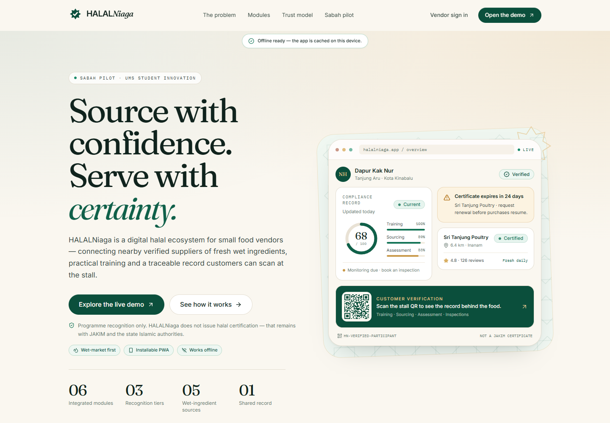
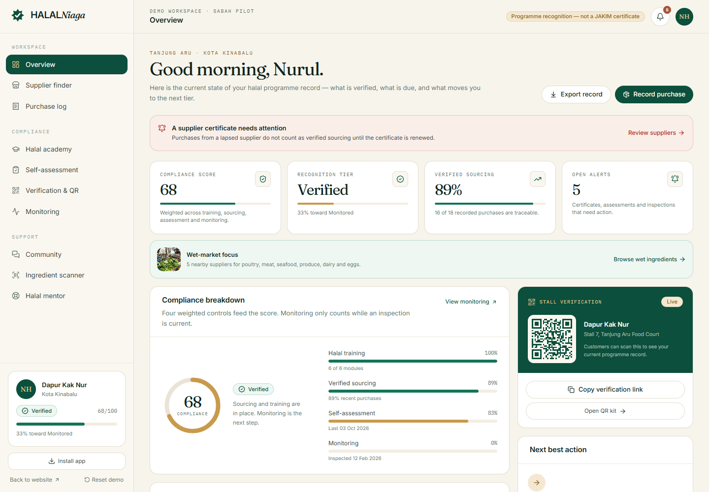
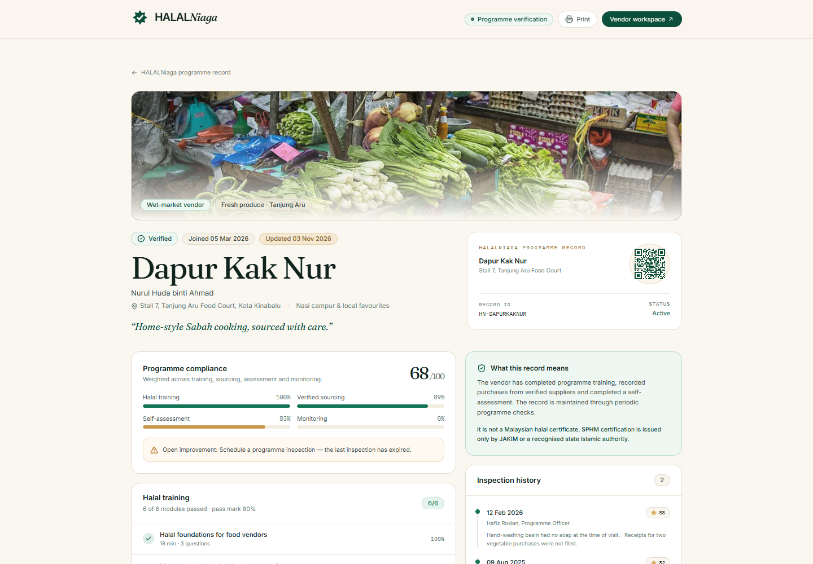
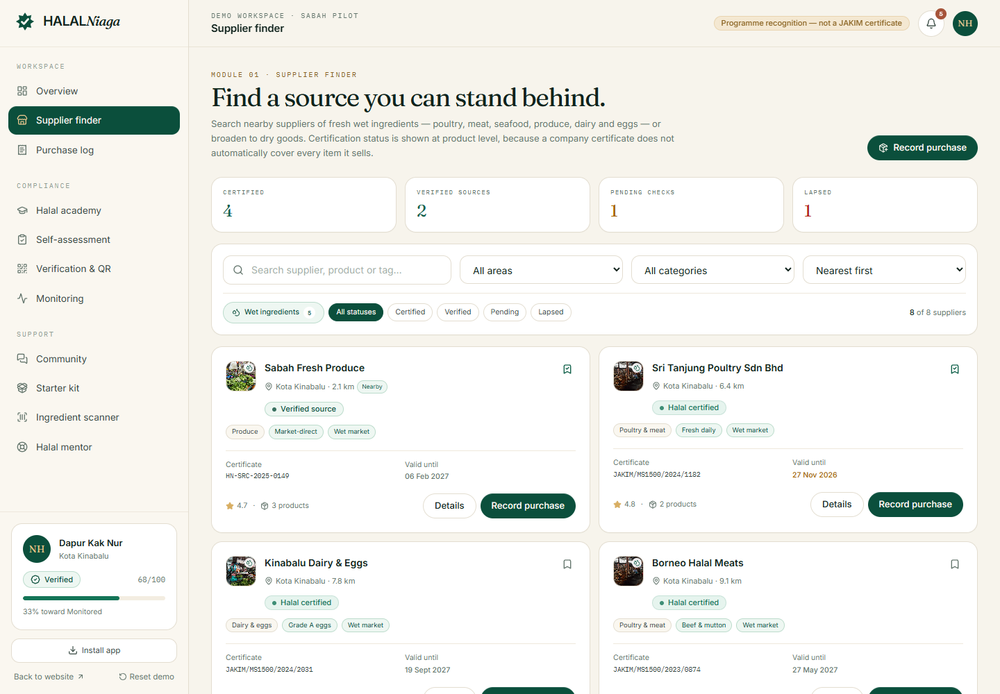
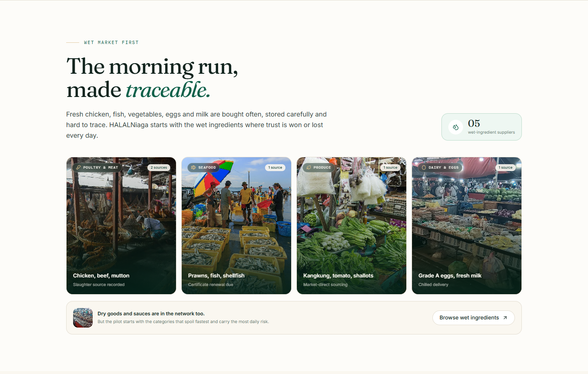
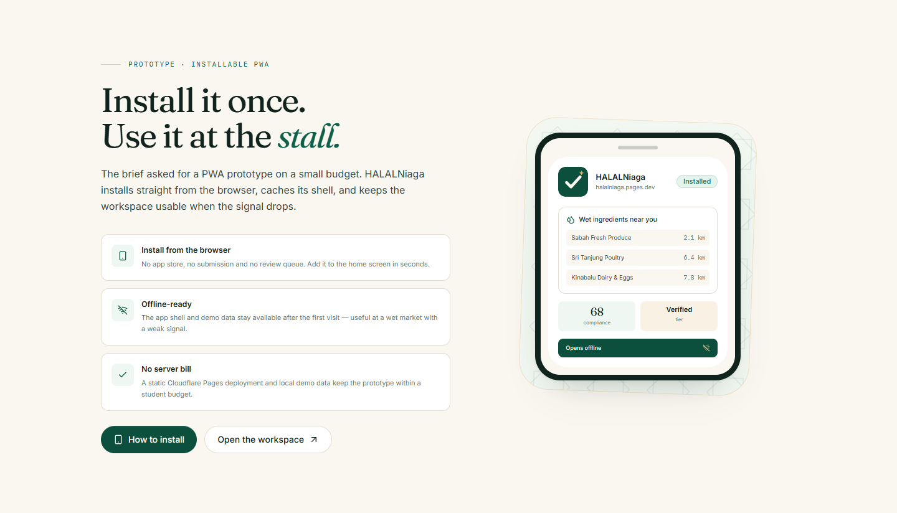
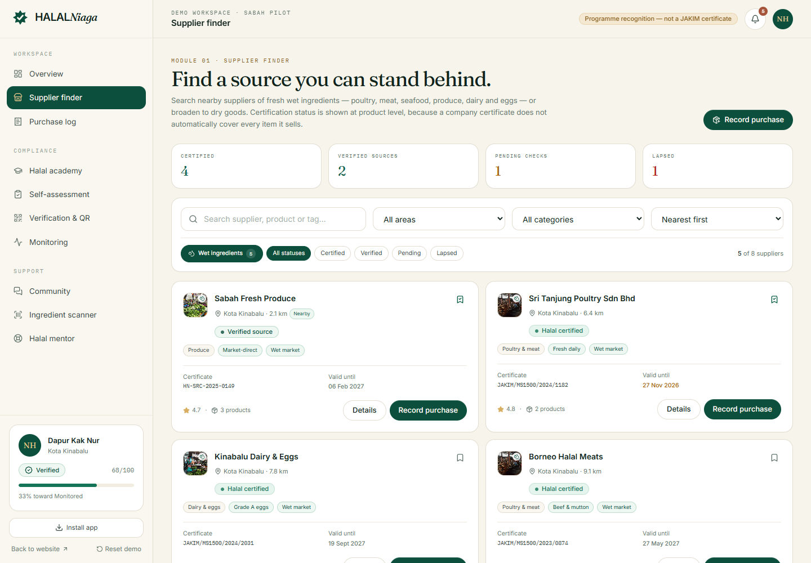
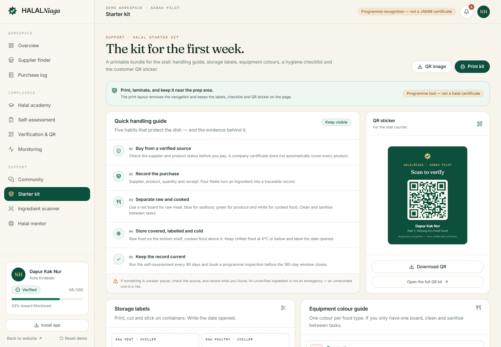
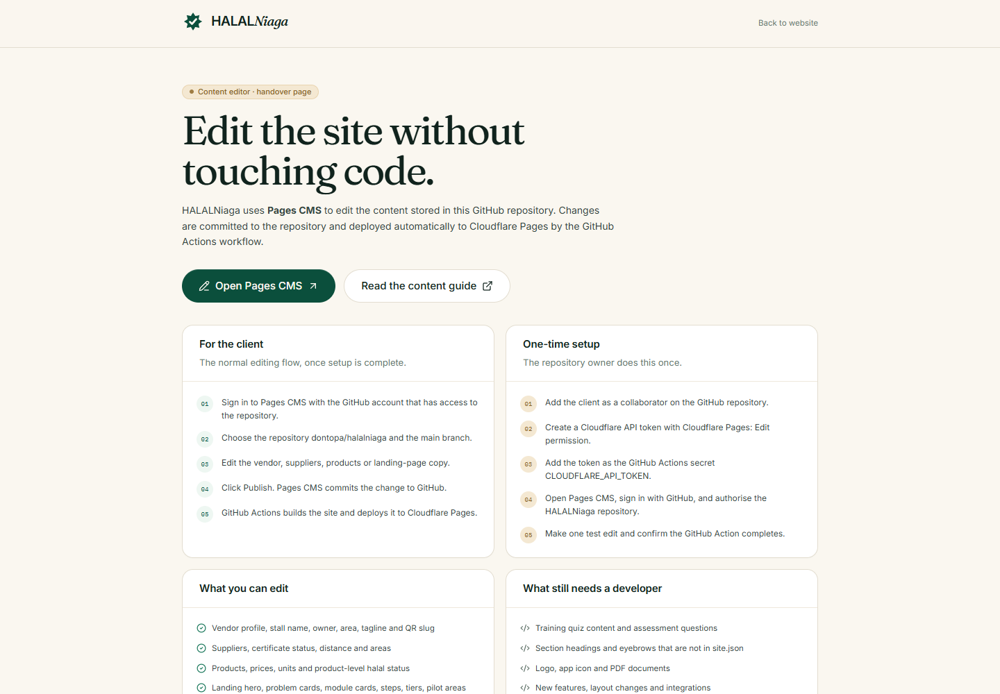

# HALALNiaga

**Source with confidence. Serve with certainty.**

A digital halal ecosystem for small food vendors — an academic innovation
prototype built for a Sabah pilot. HALALNiaga connects verified suppliers,
practical halal training, traceable purchase records and a customer-scannable
programme record.

> **Important:** HALALNiaga is a programme-recognition prototype. It does **not**
> issue halal certification. Malaysian Halal Certification (SPHM) is issued only
> by JAKIM or a recognised state Islamic authority. See
> [`docs/adr/0002-recognition-not-certification.md`](docs/adr/0002-recognition-not-certification.md).

## Live demo

- **Landing page:** https://halalniaga.pages.dev
- **Vendor workspace:** https://halalniaga.pages.dev/app
- **Public QR record:** https://halalniaga.pages.dev/vendor/dapur-kak-nur

The demo opens with a seeded vendor, **Dapur Kak Nur** (Tanjung Aru, Kota
Kinabalu), and is fully interactive. No sign-up is required.

## Client documents

- [System brief — English, 12 pages](docs/HALALNiaga-system-brief-en.pdf) ·
  [live copy](https://halalniaga.pages.dev/HALALNiaga-system-brief-en.pdf) —
  the system, modules, user flow, recognition model, PWA approach and demo.
- [System brief — Bahasa Melayu, 12 pages](docs/HALALNiaga-system-brief.pdf) ·
  [live copy](https://halalniaga.pages.dev/HALALNiaga-system-brief.pdf).
- Source HTML: [`client-brief-en.html`](docs/client-brief-en.html) and
  [`client-brief.html`](docs/client-brief.html).
- [Social preview image](public/og.png) ·
  [live](https://halalniaga.pages.dev/og.png) — 1200 × 630 Open Graph card.
- [Printable starter kit sample](docs/HALALNiaga-starter-kit-sample.pdf) —
  labels, colour guide, checklist and QR sticker.

## Client brief

This prototype was built for a UMS student team working to a limited budget:

- Help small food vendors find **nearby halal suppliers**, especially for
  **wet ingredients** — poultry, meat, seafood, produce, dairy and eggs.
- Deliver a **PWA prototype**, not a full backend or an app-store product.

The build responds with a wet-ingredient-first supplier finder (dedicated filter
and nearest-first sort), an installable offline-capable PWA, a customer QR
record, static Cloudflare Pages hosting and local demo data. No payment, backend
or app-store costs are required.

## Screens

### Landing page



### Vendor overview



### Public verification record



### Supplier finder



### Wet-ingredient sourcing



### Installable PWA



### Supplier finder — wet ingredients only



### Printable starter kit



[Download the sample PDF](docs/HALALNiaga-starter-kit-sample.pdf) — generated from
the seeded vendor with the app navigation removed.

More screens are in [`docs/screenshots/`](docs/screenshots/).

## Editing content

The client can edit the vendor, suppliers, products and key landing copy through
a form-based CMS without touching code.

- **Client editor:** https://halalniaga.pages.dev/admin (Pages CMS).
- **Content files:** `src/content/site.json`, `vendor.json`, `suppliers.json`,
  `products.json`.
- **Publish flow:** Pages CMS commits to GitHub → the
  [deploy workflow](.github/workflows/deploy.yml) builds and deploys to
  Cloudflare Pages.
- **One-time setup:** add the client as a GitHub collaborator, create a
  Cloudflare API token with **Cloudflare Pages: Edit**, add it as the
  `CLOUDFLARE_API_TOKEN` GitHub Actions secret, then authorise Pages CMS.
  The full checklist is in [`docs/CONTENT-GUIDE.md`](docs/CONTENT-GUIDE.md).

If the token secret is missing, the workflow still commits content but skips
deployment and prints a notice. The CMS form is configured in `.pages.yml`.



## Languages

The interface opens in **Bahasa Melayu** by default. A **BM / EN** switch sits in
every header — landing page, vendor workspace, public QR record, sign-in and the
admin editor — and the choice is remembered in the browser
(`halalniaga.lang`).

- UI copy lives in English in the components; Malay translations are keyed by
  the exact English source string in `src/i18n/dictionaries/*.ts`.
- Landing, vendor, supplier and product copy from `src/content/*.json` is
  translated the same way through `src/i18n/dictionaries/data.ts`. When CMS
  content is edited, add a matching entry there; otherwise the edited copy falls
  back to the language of the JSON.
- Dates and relative times follow the selected locale (`ms-MY` / `en-GB`).
- Checks: `node scripts/check-i18n.mjs` for missing or mistyped keys,
  `node scripts/audit-i18n-render.mjs` and `node scripts/scan-english.mjs` for
  English leftovers in the rendered pages (the last two need `npm run preview`).

## What it demonstrates

| Module | What a visitor can do |
| --- | --- |
| **01 · Supplier finder** | Filter eight Sabah suppliers by area, category, certificate status and a wet-ingredients toggle; sort by distance; inspect product-level halal status; save a shortlist and record a purchase |
| **02 · Halal education** | Read six practical modules and take a scored quiz; passing updates the training record |
| **03 · Purchase tracking** | Review, search, filter and export a traceable purchase log; record a new purchase (verified or unverified) |
| **04 · Self-assessment** | Complete an eight-question weighted assessment with live scoring, corrective actions and a 90-day validity cycle |
| **05 · QR verification** | Preview, copy and download the customer QR record and a printable stall sticker |
| **06 · Monitoring & recognition** | See the three-tier ladder, inspection history, certificate watchlist and record a simulated programme inspection |
| **Support** | Community feed, simulated ingredient barcode scanner, a scripted halal mentor conversation, and a printable starter kit (labels, colour guide, checklist, QR sticker) |
| **PWA** | Install from the browser, reopen `/app` offline, and keep the cached shell available at a market with a weak signal |

The public record at `/vendor/dapur-kak-nur` is the customer-facing view: tier,
training, source records, assessment band, inspection history and a clear
certification disclaimer.

## The compliance model

The score is a presentation metric, not a legal determination:

```
score = 0.25 × training% + 0.25 × sourcing%
      + 0.25 × assessment% + 0.25 × monitoring%
```

Recognition tiers are ordered and evidence-based:

1. **Participant** — all six modules passed at 80% or higher.
2. **Verification** — Participant + ≥80% traceable recent purchases + ≥80%
   self-assessment within 90 days.
3. **Monitoring** — Verification + a passing programme inspection within
   180 days.

Tiers expire with their evidence. A vendor can be Verified and still score below
80 overall because the monitoring component is zero until an inspection is
current. That distinction is intentional and visible in the UI.

## Demo data

Everything is seeded in [`src/domain/seed.ts`](src/domain/seed.ts):

- 1 vendor, 2 programme inspections
- 8 suppliers across five Sabah districts (certified, verified, pending and
  lapsed certificate states)
- 16 products with barcodes and product-level status
- 18 purchases over the last four months, including two untraceable records
- 6 training modules with 18 quiz questions
- 8 weighted self-assessment questions
- Community posts, mentor messages and live-derived alerts

Data is persisted to `localStorage` under `halalniaga.state.v1`. Use **Reset
demo** in the sidebar to restore the seed.

## Tech stack

- **React 19 + TypeScript + Vite 7**
- **Tailwind CSS v4** with a custom token layer
- **React Router 7** with route-level code splitting
- **Recharts** for the sourcing chart
- **qrcode.react** for verification and sticker generation
- **Lucide** icons
- **Vitest** for domain unit tests
- **vite-plugin-pwa / Workbox** for the manifest, icons and offline caching
- **Cloudflare Pages** for hosting

## Getting started

```bash
npm install
npm run dev        # http://localhost:5173
npm run test       # domain rules
npm run build      # typecheck + production build
npm run preview    # preview the built app
```

Node 20+ is recommended (built on Node 24).

Mobile layout is checked at 320, 360 and 390 px across every route — no
horizontal page scroll. Wide tables scroll inside their cards instead.

## Project structure

```
src/
  content/         # CMS-editable JSON (site, vendor, suppliers, products)
  domain/          # framework-free business logic + seed + store
    types.ts       # ubiquitous language (see CONTEXT.md)
    compliance.ts  # scoring, tiers, alerts, date rules
    seed.ts        # merges content JSON with generated demo records
    store.tsx      # localStorage-backed React context
    compliance.test.ts
  components/
    ui/            # buttons, cards, badges, fields, modal, progress
    app/           # app shell, purchase modal, shared page pieces
    pwa/           # install prompt, offline status and install instructions
    Logo.tsx       # the Verified Seal and wordmark
  lib/             # class merge, image paths and photo credits
  pages/
    Landing.tsx
    SignIn.tsx
    PublicVendor.tsx
    Credits.tsx
    Admin.tsx      # handover page for the client content editor
    app/           # eleven workspace modules, including the printable starter kit
public/
  images/          # Sabah market photography (WebP, credited)
  icons/           # PWA, maskable and Apple touch icons
  ...              # logo variants, favicon, pattern, OG card
docs/
  adr/             # architecture and policy decisions
  brand.md         # logo construction, colour, type, misuse
  demo-script.md   # 8-minute presentation walkthrough
  image-credits.md # photo authors, licences and sources
CONTEXT.md         # domain glossary and invariants
```

## Testing

```bash
npm run test
```

The domain suite covers:

- weighted self-assessment scoring, N/A handling and the critical-control cap
- tier calculation from seeded evidence
- expiry rules for inspections and assessments
- alert derivation (certificate expiry, untraceable purchases, overdue records)
- promotion to Monitored after a current inspection
- seed integrity (every purchase resolves to a real supplier and product)

## PWA and offline behaviour

- The production build ships `manifest.webmanifest`, 192 px and 512 px icons, a
  maskable icon and an Apple touch icon.
- A Workbox service worker precaches the app shell and route chunks on the first
  visit. Deep links such as `/app` and `/vendor/dapur-kak-nur` resolve through
  the cached shell.
- This was verified by loading `/app` with the browser set to offline after the
  first visit; the dashboard still rendered.
- Install from the browser (Android/desktop) or use Share → Add to Home Screen
  on iOS. The landing banner and the sidebar **Install app** button both open
  the instructions.
- Demo data stays in `localStorage`, so it remains available offline on the same
  device.
- The installed app starts at `/app` (the vendor workspace), not the landing
  page; the browser root `/` remains the public landing page.
- Run `npm run build && npm run preview`, then open the preview in Chrome to see
  the service worker and manifest.

## Deployment

The live site is deployed to **Cloudflare Pages** at
`https://halalniaga.pages.dev`.

```bash
npx wrangler login
npm run deploy
```

`npm run deploy` builds the app, writes the Pages SPA fallback to
`dist/_redirects`, and uploads `dist/` to the `halalniaga` Pages project. Deep
links such as `/app/suppliers` and `/vendor/dapur-kak-nur` resolve correctly.

Pushes to `main` also trigger `.github/workflows/deploy.yml`; the workflow skips
deployment until the `CLOUDFLARE_API_TOKEN` secret is set.

The Pages project is already created. To create it from scratch, run
`npx wrangler pages project create halalniaga --production-branch main` first.

## Limitations

- This is a **prototype**, not a production compliance system.
- Data is stored per browser. Changes do not sync between devices. The PWA caches
  the application shell, not a shared server record.
- Market photographs are illustrative; they do not depict the seeded vendor or
  the named suppliers.
- Certificate status, supplier details and inspection records are illustrative.
- The scanner and mentor are simulated; there is no camera, payment, email or
  supplier integration.
- No real authentication. The sign-in page is a presentation flow.
- Nothing here constitutes a halal certification decision.

## Image credits

Market photography is from Wikimedia Commons, used under CC BY-SA 3.0/4.0 and
CC BY 3.0. Authors, licences and source links are in
[`docs/image-credits.md`](docs/image-credits.md) and in the app at `/credits`.
The images were cropped, resized and converted to WebP; those derivatives are
shared under the same licences.

## Academic context

Built as a working prototype for the **HALALNiaga** innovation proposal by a
Universiti Malaysia Sabah (UMS) student team:
*"Aplikasi Ekosistem Digital bagi Memperkasa Pematuhan Halal dalam Kalangan
Peniaga Makanan Kecil-kecilan"*. The client brief asked for a PWA prototype on a
limited budget, focused on nearby halal suppliers for wet ingredients and on
making the evidence behind the food visible to customers.

The identity and interface were designed in this repository; the logo concept and
construction notes are in [`docs/brand.md`](docs/brand.md).
